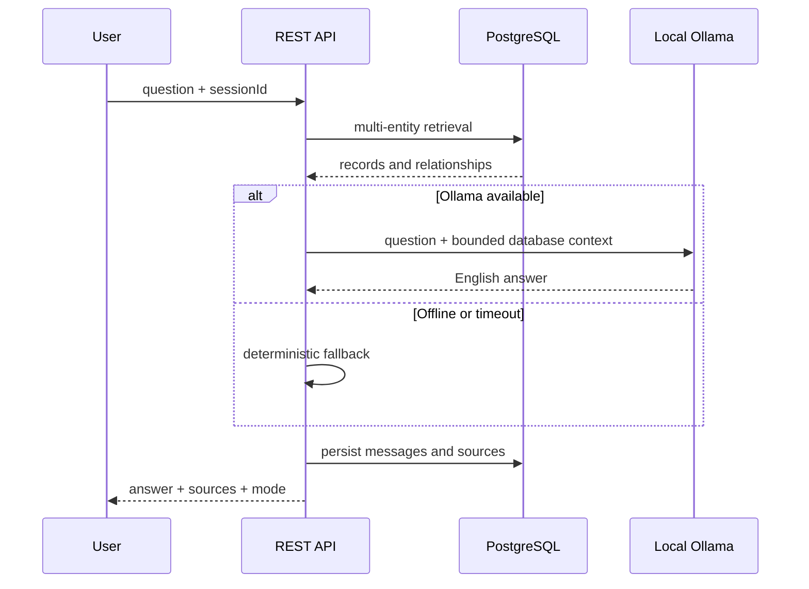

# Local AI and Retrieval Architecture

The assistant uses the center's publications, researchers, projects, and research areas as its only knowledge source. Ollama improves wording but never determines authoritative sources.



Run Ollama locally or through its official Docker image, then pull `qwen2.5:0.5b`. Configure `OLLAMA_URL`, `OLLAMA_MODEL`, and `OLLAMA_TIMEOUT_MS` as needed. The default 60-second timeout accommodates CPU inference; database fallback remains available if generation fails.

Queries are normalized, common question words are removed, and abbreviations such as AI, ML, NLP, and IoT are expanded. Retrieval searches titles, abstracts, venues, people, affiliations, funding, related authors, teams, projects, and areas. Project-status questions are mapped to the status enum, while list and count questions have database-aware handling. Ollama is instructed to use only supplied context. Up to eight clickable sources accompany the answer. If nothing matches, the assistant states that the information is absent. Future improvements may use PostgreSQL full-text search or local `pgvector` embeddings.

## Docker and low-memory computers

The official `ollama/ollama` image can expose Ollama on port `11434` while keeping models in a named Docker volume. `llama3.2:3b` provides better wording but may be killed when the host has insufficient free RAM. For an 8 GB development laptop running Docker Desktop and an IDE, use the smaller `qwen2.5:0.5b` model:

```bash
docker exec -it zurc-ollama ollama pull qwen2.5:0.5b
```

Then configure `server/.env` with `OLLAMA_MODEL="qwen2.5:0.5b"` and restart the backend. Generation uses a 4,096-token context and low temperature. Center metadata answers are capped at 350 output tokens; document evidence/synthesis requests use bounded budgets up to 1,200 output tokens. These settings reduce memory use and discourage unsupported elaboration. The deterministic database fallback remains the authoritative safety mechanism.

## Full-document analysis

The center-wide assistant above searches metadata. Publication-context mode reads extracted PDF chunks through a separate summary/QA pipeline. Every text-bearing page participates in evidence processing; summaries balance research sections, and question answers cite supplied pages. Conservative source quotations replace unsupported summary paraphrases. Offline fallback displays actual page-cited passages and is explicitly labeled. See [document pipeline, local generation constraints, and limitations](PUBLICATION_DOCUMENTS.md) and [investigation](PROJECT_INVESTIGATION.md).
