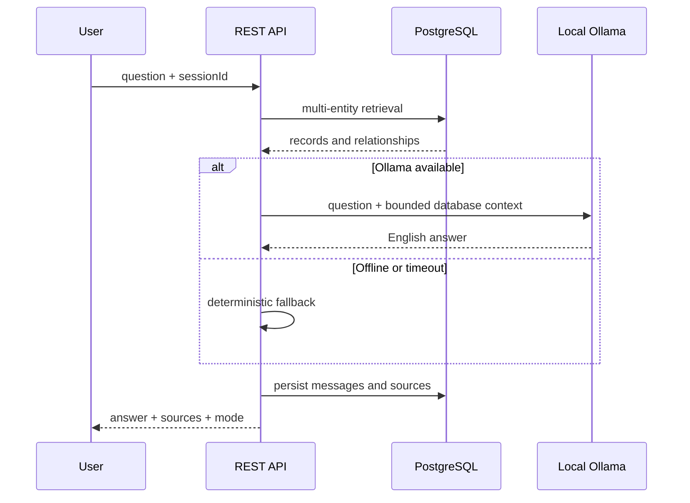

# Local AI and Retrieval Architecture

The assistant uses the center's publications, researchers, projects, and research areas as its only knowledge source. Ollama improves wording but never determines authoritative sources.

Install Ollama, run `ollama pull llama3.2:3b`, then `ollama serve`. Configure `OLLAMA_URL` and `OLLAMA_MODEL` as needed. Calls time out after six seconds.

Queries are normalized and searched case-insensitively across titles, abstracts, names, positions, interests, and descriptions. Related authors, teams, and areas are loaded with results. Ollama is instructed to use only supplied context. Up to eight clickable sources accompany the answer. If nothing matches, the assistant states that the information is absent. Future improvements may use PostgreSQL full-text search or local `pgvector` embeddings.
