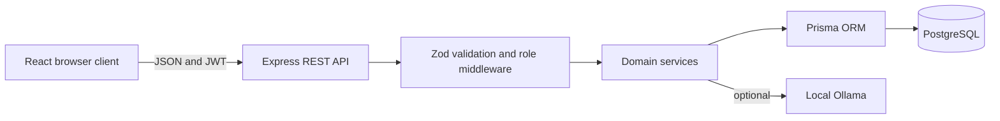
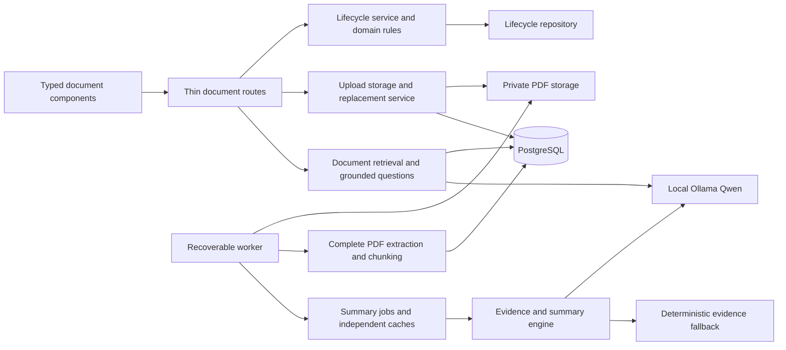

# Architecture

The npm monorepo contains `client/` for React/Vite and `server/` for Express and Prisma. The modular monolith keeps deployment straightforward while separating presentation, transport, business logic, validation, and persistence.

Backend directories cover configuration, controllers, routes, services, validation, middleware, and shared utilities. Prisma provides typed repository access. Frontend directories separate pages, reusable components, layouts, API services, hooks, and authentication state.

Passwords use bcrypt with cost 12. Successful login returns a signed JWT containing identity and role. `authenticate` verifies the token, loads the active account and current role from PostgreSQL, and `authorize` enforces roles at the API boundary. Responsive grids move from four or three columns to two and then one; navigation, details, chat, forms, tables, and the admin sidebar each have intentionally designed mobile behavior.

## Publication document boundaries

Factories inject small repository/generator interfaces; default infrastructure bindings are composed separately from HTTP routes. Generation is separated from Prisma summary jobs. The frontend separates typed transport, cancellation-safe processing polling, evidence links, structured summaries, questions, draft editing, and review. [Investigation and SOLID decisions](PROJECT_INVESTIGATION.md) records the rationale and remaining legacy refactoring limits. See [worker recovery and workflow](PUBLICATION_DOCUMENTS.md).
