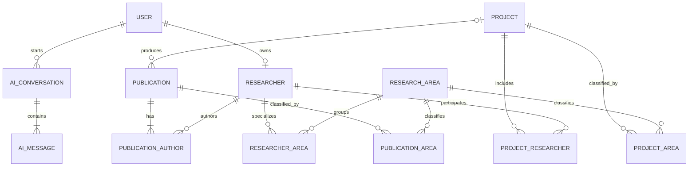

# Database Documentation

PostgreSQL is managed through Prisma. The authoritative schema is `server/prisma/schema.prisma`; the generated SQL migration is under `server/prisma/migrations`. Dependent join rows use `CASCADE`, while optional identity/project links use `SET NULL`.

## Data dictionary

| Table | Fields and constraints |
|---|---|
| `User` | `id PK`, `email UNIQUE`, `passwordHash`, names, `role`, `active`, timestamps; role/status index. |
| `Researcher` | `id PK`, `userId FK UNIQUE?`, name, `slug UNIQUE`, biography, position, `email UNIQUE`, photo, affiliation, `orcid UNIQUE?`, external profiles, interests array, active, timestamps. |
| `ResearchArea` | `id PK`, `name UNIQUE`, `slug UNIQUE`, description, icon/image, objectives array, timestamps. |
| `ResearcherArea` | Composite PK/FKs `(researcherId, areaId)`. |
| `Project` | `id PK`, title, `slug UNIQUE`, descriptions, objectives, dates, status, funding, featured, timestamps; status/date and title indexes. |
| `ProjectArea` | Composite PK/FKs `(projectId, areaId)`. |
| `ProjectResearcher` | Composite PK/FKs `(projectId, researcherId)`, membership role. |
| `Publication` | `id PK`, title, `slug UNIQUE`, abstract, date, `doi UNIQUE?`, venue, keywords, type, URLs, featured, `projectId FK?`, timestamps; date/type/title indexes. |
| `PublicationAuthor` | Composite PK/FKs `(publicationId, researcherId)`, unique author order per publication, corresponding flag. |
| `PublicationArea` | Composite PK/FKs `(publicationId, areaId)`. |
| `Event` | `id PK`, title, `slug UNIQUE`, description, dates, location, image/registration URLs, published, timestamps. |
| `News` | `id PK`, title, `slug UNIQUE`, excerpt, content, image, publication state/date, timestamps. |
| `Resource` | `id PK`, title, description, type, URL, published, timestamps. |
| `ContactMessage` | `id PK`, sender fields, subject, message, status, timestamps; status/date index. |
| `AiConversation` | `id PK`, optional user FK, indexed session ID, title, timestamps. |
| `AiMessage` | `id PK`, conversation FK, role, text content, JSON sources, creation time. |

Enums are `Role`, `ProjectStatus`, `PublicationType`, `ResourceType`, `MessageStatus`, and `AiRole` as defined in Prisma.

## ERD / conceptual data model

## Business rules and normalization

A researcher can occur only once in a given project, area, or publication. Author order is unique within a publication. A publication belongs to zero or one project and multiple research areas. A user has zero or one researcher profile. Many-to-many relationships are represented by proper join tables, never comma-separated IDs. Descriptive attributes depend on their entity key, while relationship properties such as project role and author order reside in their join entity; the design satisfies third normal form.
