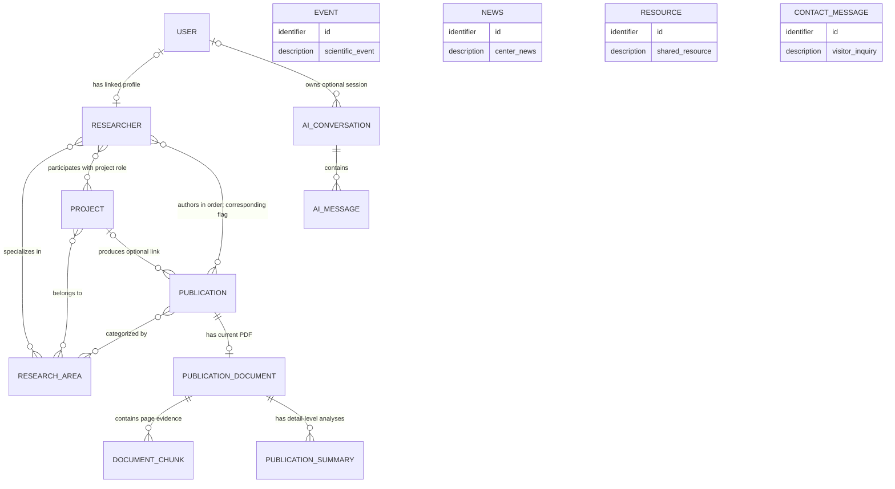
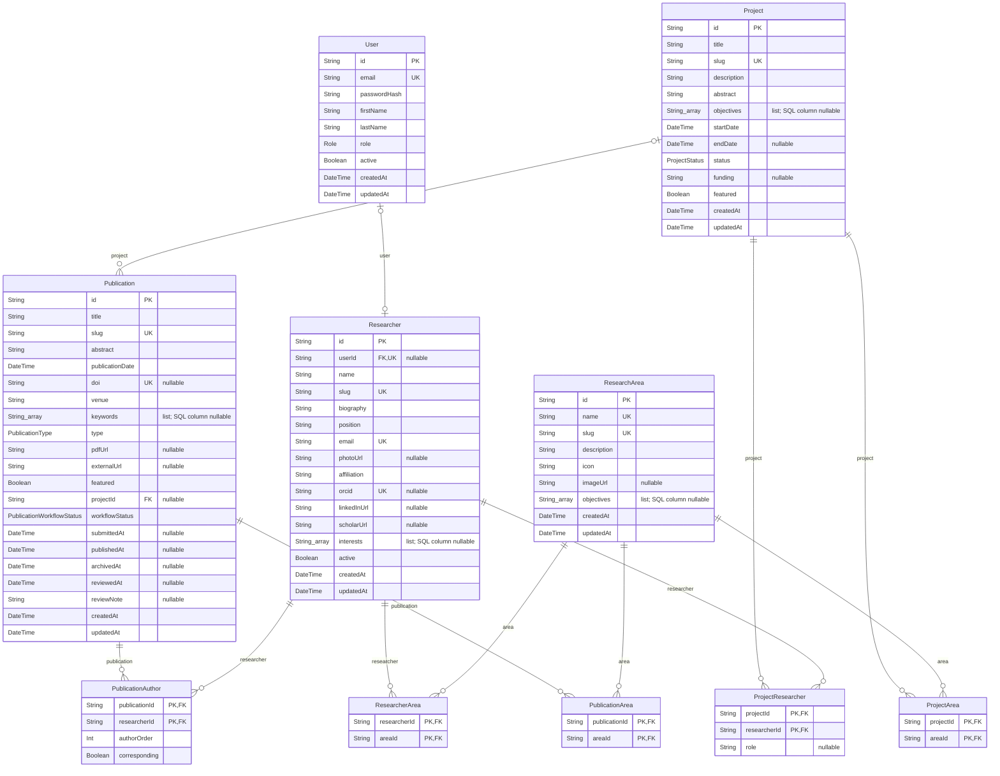
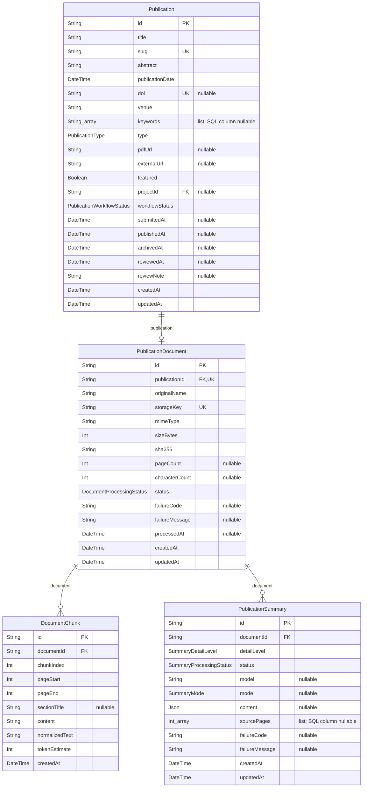
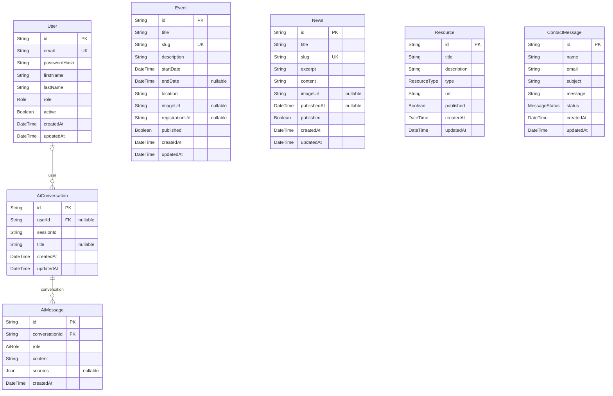

# ZURC conceptual and logical data models

Schema snapshot: 1 October 2026; derived from server/prisma/schema.prisma and the two committed PostgreSQL migrations. **19 tables, 11 enums, 168 stored fields.** The source schema is authoritative after future changes. These models describe implemented storage, not proposed additions.

## Reading the models

- Conceptual model (MCD): business entities and association cardinalities; many-to-many relationships stay conceptual associations.
- Logical model (MLD): implemented relational tables, scalar attributes, PK/FK/unique identifiers and junction tables. The dictionary also provides PostgreSQL types/defaults as report supplements.
- `PK` = primary key; `FK` = foreign key; `UK` = single-column unique key. Composite unique keys are listed separately.
- Mermaid: `||` means exactly one, `o|` zero or one, and `o{` zero or many. A FK requires an existing parent unless nullable; a parent can have zero children.
- String identifiers are CUID-generated TEXT, not auto-increment integers. `slug` is a unique URL identifier, not the primary key.
- Prisma relation fields (e.g. authors, document, user) are navigation properties, not additional columns. Their FKs/associations appear below.
- Arrays are Prisma scalar lists; committed migrations allow SQL NULL for these list columns. Application code uses arrays; distinguish this SQL detail from nullable scalar fields marked `?`.

## Conceptual model — MCD

EVENT, NEWS, RESOURCE and CONTACT_MESSAGE are standalone entities in the current schema. There is no event-registration, resource-owner or contact-user FK. USER role is an attribute, not a separate administrator/visitor entity. Research authors are RESEARCHER records rather than USER rows.

Conceptual association attributes: authorship has authorOrder and corresponding; project participation has an optional role. The remaining many-to-many associations have no non-key attributes.

## Logical model — MLD

Full editable Mermaid source: [zurc-logical.mmd](diagrams/zurc-logical.mmd). Conceptual source: [zurc-conceptual.mmd](diagrams/zurc-conceptual.mmd). Paste these into a Mermaid-capable editor to export SVG/PDF for the report. Prefer landscape pages and the domain panels below for legibility; do not shrink all 19 tables onto one portrait page.

### Accounts and research catalogue

### Publication document processing

### Public content and AI conversations

## Complete field dictionary

Default `now()` maps to CURRENT_TIMESTAMP. `cuid()` and `@updatedAt` are supplied by Prisma, not PostgreSQL defaults. `—` means no declared default/constraint. Array fields must be supplied by application logic where needed. SQL nullable reflects the actual migrations.

### User

| Field        | Prisma type | PostgreSQL type | SQL nullable | Key / reference | Default / generated behavior |
| ------------ | ----------- | --------------- | ------------ | --------------- | ---------------------------- |
| id           | String      | TEXT            | No           | PK              | cuid()                       |
| email        | String      | TEXT            | No           | UK              | —                            |
| passwordHash | String      | TEXT            | No           | —               | —                            |
| firstName    | String      | TEXT            | No           | —               | —                            |
| lastName     | String      | TEXT            | No           | —               | —                            |
| role         | Role        | Role            | No           | —               | RESEARCHER                   |
| active       | Boolean     | BOOLEAN         | No           | —               | true                         |
| createdAt    | DateTime    | TIMESTAMP(3)    | No           | —               | now()                        |
| updatedAt    | DateTime    | TIMESTAMP(3)    | No           | —               | Prisma @updatedAt            |

**Table constraints / indexes:** `@@index([role, active])`

**Prisma relation properties (not columns):** `researcher: Researcher?`, `conversations: AiConversation[]`.

### Researcher

| Field       | Prisma type | PostgreSQL type | SQL nullable | Key / reference                  | Default / generated behavior |
| ----------- | ----------- | --------------- | ------------ | -------------------------------- | ---------------------------- |
| id          | String      | TEXT            | No           | PK                               | cuid()                       |
| userId      | String?     | TEXT            | Yes          | UK; FK → User.id; delete SetNull | —                            |
| name        | String      | TEXT            | No           | —                                | —                            |
| slug        | String      | TEXT            | No           | UK                               | —                            |
| biography   | String      | TEXT            | No           | —                                | —                            |
| position    | String      | TEXT            | No           | —                                | —                            |
| email       | String      | TEXT            | No           | UK                               | —                            |
| photoUrl    | String?     | TEXT            | Yes          | —                                | —                            |
| affiliation | String      | TEXT            | No           | —                                | —                            |
| orcid       | String?     | TEXT            | Yes          | UK                               | —                            |
| linkedInUrl | String?     | TEXT            | Yes          | —                                | —                            |
| scholarUrl  | String?     | TEXT            | Yes          | —                                | —                            |
| interests   | String[]    | TEXT[]          | Yes          | —                                | —                            |
| active      | Boolean     | BOOLEAN         | No           | —                                | true                         |
| createdAt   | DateTime    | TIMESTAMP(3)    | No           | —                                | now()                        |
| updatedAt   | DateTime    | TIMESTAMP(3)    | No           | —                                | Prisma @updatedAt            |

**Table constraints / indexes:** `@@index([name])`

**Prisma relation properties (not columns):** `user: User?`, `areas: ResearcherArea[]`, `publications: PublicationAuthor[]`, `projects: ProjectResearcher[]`.

### ResearchArea

| Field       | Prisma type | PostgreSQL type | SQL nullable | Key / reference | Default / generated behavior |
| ----------- | ----------- | --------------- | ------------ | --------------- | ---------------------------- |
| id          | String      | TEXT            | No           | PK              | cuid()                       |
| name        | String      | TEXT            | No           | UK              | —                            |
| slug        | String      | TEXT            | No           | UK              | —                            |
| description | String      | TEXT            | No           | —               | —                            |
| icon        | String      | TEXT            | No           | —               | —                            |
| imageUrl    | String?     | TEXT            | Yes          | —               | —                            |
| objectives  | String[]    | TEXT[]          | Yes          | —               | —                            |
| createdAt   | DateTime    | TIMESTAMP(3)    | No           | —               | now()                        |
| updatedAt   | DateTime    | TIMESTAMP(3)    | No           | —               | Prisma @updatedAt            |

**Table constraints / indexes:** Primary key / single-field unique constraints shown above; no additional declared indexes.

**Prisma relation properties (not columns):** `researchers: ResearcherArea[]`, `projects: ProjectArea[]`, `publications: PublicationArea[]`.

### ResearcherArea

| Field        | Prisma type | PostgreSQL type | SQL nullable | Key / reference                                    | Default / generated behavior |
| ------------ | ----------- | --------------- | ------------ | -------------------------------------------------- | ---------------------------- |
| researcherId | String      | TEXT            | No           | composite PK; FK → Researcher.id; delete Cascade   | —                            |
| areaId       | String      | TEXT            | No           | composite PK; FK → ResearchArea.id; delete Cascade | —                            |

**Table constraints / indexes:** `@@id([researcherId, areaId])`

**Prisma relation properties (not columns):** `researcher: Researcher`, `area: ResearchArea`.

### Project

| Field       | Prisma type   | PostgreSQL type | SQL nullable | Key / reference | Default / generated behavior |
| ----------- | ------------- | --------------- | ------------ | --------------- | ---------------------------- |
| id          | String        | TEXT            | No           | PK              | cuid()                       |
| title       | String        | TEXT            | No           | —               | —                            |
| slug        | String        | TEXT            | No           | UK              | —                            |
| description | String        | TEXT            | No           | —               | —                            |
| abstract    | String        | TEXT            | No           | —               | —                            |
| objectives  | String[]      | TEXT[]          | Yes          | —               | —                            |
| startDate   | DateTime      | TIMESTAMP(3)    | No           | —               | —                            |
| endDate     | DateTime?     | TIMESTAMP(3)    | Yes          | —               | —                            |
| status      | ProjectStatus | ProjectStatus   | No           | —               | PLANNED                      |
| funding     | String?       | TEXT            | Yes          | —               | —                            |
| featured    | Boolean       | BOOLEAN         | No           | —               | false                        |
| createdAt   | DateTime      | TIMESTAMP(3)    | No           | —               | now()                        |
| updatedAt   | DateTime      | TIMESTAMP(3)    | No           | —               | Prisma @updatedAt            |

**Table constraints / indexes:** `@@index([status, startDate])`; `@@index([title])`

**Prisma relation properties (not columns):** `areas: ProjectArea[]`, `researchers: ProjectResearcher[]`, `publications: Publication[]`.

### ProjectArea

| Field     | Prisma type | PostgreSQL type | SQL nullable | Key / reference                                    | Default / generated behavior |
| --------- | ----------- | --------------- | ------------ | -------------------------------------------------- | ---------------------------- |
| projectId | String      | TEXT            | No           | composite PK; FK → Project.id; delete Cascade      | —                            |
| areaId    | String      | TEXT            | No           | composite PK; FK → ResearchArea.id; delete Cascade | —                            |

**Table constraints / indexes:** `@@id([projectId, areaId])`

**Prisma relation properties (not columns):** `project: Project`, `area: ResearchArea`.

### ProjectResearcher

| Field        | Prisma type | PostgreSQL type | SQL nullable | Key / reference                                  | Default / generated behavior |
| ------------ | ----------- | --------------- | ------------ | ------------------------------------------------ | ---------------------------- |
| projectId    | String      | TEXT            | No           | composite PK; FK → Project.id; delete Cascade    | —                            |
| researcherId | String      | TEXT            | No           | composite PK; FK → Researcher.id; delete Cascade | —                            |
| role         | String?     | TEXT            | Yes          | —                                                | —                            |

**Table constraints / indexes:** `@@id([projectId, researcherId])`

**Prisma relation properties (not columns):** `project: Project`, `researcher: Researcher`.

### Publication

| Field           | Prisma type               | PostgreSQL type           | SQL nullable | Key / reference                 | Default / generated behavior |
| --------------- | ------------------------- | ------------------------- | ------------ | ------------------------------- | ---------------------------- |
| id              | String                    | TEXT                      | No           | PK                              | cuid()                       |
| title           | String                    | TEXT                      | No           | —                               | —                            |
| slug            | String                    | TEXT                      | No           | UK                              | —                            |
| abstract        | String                    | TEXT                      | No           | —                               | —                            |
| publicationDate | DateTime                  | TIMESTAMP(3)              | No           | —                               | —                            |
| doi             | String?                   | TEXT                      | Yes          | UK                              | —                            |
| venue           | String                    | TEXT                      | No           | —                               | —                            |
| keywords        | String[]                  | TEXT[]                    | Yes          | —                               | —                            |
| type            | PublicationType           | PublicationType           | No           | —                               | —                            |
| pdfUrl          | String?                   | TEXT                      | Yes          | —                               | —                            |
| externalUrl     | String?                   | TEXT                      | Yes          | —                               | —                            |
| featured        | Boolean                   | BOOLEAN                   | No           | —                               | false                        |
| projectId       | String?                   | TEXT                      | Yes          | FK → Project.id; delete SetNull | —                            |
| workflowStatus  | PublicationWorkflowStatus | PublicationWorkflowStatus | No           | —                               | DRAFT                        |
| submittedAt     | DateTime?                 | TIMESTAMP(3)              | Yes          | —                               | —                            |
| publishedAt     | DateTime?                 | TIMESTAMP(3)              | Yes          | —                               | —                            |
| archivedAt      | DateTime?                 | TIMESTAMP(3)              | Yes          | —                               | —                            |
| reviewedAt      | DateTime?                 | TIMESTAMP(3)              | Yes          | —                               | —                            |
| reviewNote      | String?                   | TEXT                      | Yes          | —                               | —                            |
| createdAt       | DateTime                  | TIMESTAMP(3)              | No           | —                               | now()                        |
| updatedAt       | DateTime                  | TIMESTAMP(3)              | No           | —                               | Prisma @updatedAt            |

**Table constraints / indexes:** `@@index([publicationDate])`; `@@index([type])`; `@@index([title])`

**Prisma relation properties (not columns):** `project: Project?`, `document: PublicationDocument?`, `authors: PublicationAuthor[]`, `areas: PublicationArea[]`.

### PublicationDocument

| Field          | Prisma type              | PostgreSQL type          | SQL nullable | Key / reference                         | Default / generated behavior |
| -------------- | ------------------------ | ------------------------ | ------------ | --------------------------------------- | ---------------------------- |
| id             | String                   | TEXT                     | No           | PK                                      | cuid()                       |
| publicationId  | String                   | TEXT                     | No           | UK; FK → Publication.id; delete Cascade | —                            |
| originalName   | String                   | TEXT                     | No           | —                                       | —                            |
| storageKey     | String                   | TEXT                     | No           | UK                                      | —                            |
| mimeType       | String                   | TEXT                     | No           | —                                       | —                            |
| sizeBytes      | Int                      | INTEGER                  | No           | —                                       | —                            |
| sha256         | String                   | TEXT                     | No           | —                                       | —                            |
| pageCount      | Int?                     | INTEGER                  | Yes          | —                                       | —                            |
| characterCount | Int?                     | INTEGER                  | Yes          | —                                       | —                            |
| status         | DocumentProcessingStatus | DocumentProcessingStatus | No           | —                                       | PENDING                      |
| failureCode    | String?                  | TEXT                     | Yes          | —                                       | —                            |
| failureMessage | String?                  | TEXT                     | Yes          | —                                       | —                            |
| processedAt    | DateTime?                | TIMESTAMP(3)             | Yes          | —                                       | —                            |
| createdAt      | DateTime                 | TIMESTAMP(3)             | No           | —                                       | now()                        |
| updatedAt      | DateTime                 | TIMESTAMP(3)             | No           | —                                       | Prisma @updatedAt            |

**Table constraints / indexes:** `@@index([status, createdAt])`

**Prisma relation properties (not columns):** `publication: Publication`, `chunks: DocumentChunk[]`, `summaries: PublicationSummary[]`.

### DocumentChunk

| Field          | Prisma type | PostgreSQL type | SQL nullable | Key / reference                             | Default / generated behavior |
| -------------- | ----------- | --------------- | ------------ | ------------------------------------------- | ---------------------------- |
| id             | String      | TEXT            | No           | PK                                          | cuid()                       |
| documentId     | String      | TEXT            | No           | FK → PublicationDocument.id; delete Cascade | —                            |
| chunkIndex     | Int         | INTEGER         | No           | —                                           | —                            |
| pageStart      | Int         | INTEGER         | No           | —                                           | —                            |
| pageEnd        | Int         | INTEGER         | No           | —                                           | —                            |
| sectionTitle   | String?     | TEXT            | Yes          | —                                           | —                            |
| content        | String      | TEXT            | No           | —                                           | —                            |
| normalizedText | String      | TEXT            | No           | —                                           | —                            |
| tokenEstimate  | Int         | INTEGER         | No           | —                                           | —                            |
| createdAt      | DateTime    | TIMESTAMP(3)    | No           | —                                           | now()                        |

**Table constraints / indexes:** `@@unique([documentId, chunkIndex])`; `@@index([documentId, pageStart])`

**Prisma relation properties (not columns):** `document: PublicationDocument`.

### PublicationSummary

| Field          | Prisma type             | PostgreSQL type         | SQL nullable | Key / reference                             | Default / generated behavior |
| -------------- | ----------------------- | ----------------------- | ------------ | ------------------------------------------- | ---------------------------- |
| id             | String                  | TEXT                    | No           | PK                                          | cuid()                       |
| documentId     | String                  | TEXT                    | No           | FK → PublicationDocument.id; delete Cascade | —                            |
| detailLevel    | SummaryDetailLevel      | SummaryDetailLevel      | No           | —                                           | —                            |
| status         | SummaryProcessingStatus | SummaryProcessingStatus | No           | —                                           | PENDING                      |
| model          | String?                 | TEXT                    | Yes          | —                                           | —                            |
| mode           | SummaryMode?            | SummaryMode             | Yes          | —                                           | —                            |
| content        | Json?                   | JSONB                   | Yes          | —                                           | —                            |
| sourcePages    | Int[]                   | INTEGER[]               | Yes          | —                                           | —                            |
| failureCode    | String?                 | TEXT                    | Yes          | —                                           | —                            |
| failureMessage | String?                 | TEXT                    | Yes          | —                                           | —                            |
| createdAt      | DateTime                | TIMESTAMP(3)            | No           | —                                           | now()                        |
| updatedAt      | DateTime                | TIMESTAMP(3)            | No           | —                                           | Prisma @updatedAt            |

**Table constraints / indexes:** `@@unique([documentId, detailLevel])`; `@@index([status, createdAt])`

**Prisma relation properties (not columns):** `document: PublicationDocument`.

### PublicationAuthor

| Field         | Prisma type | PostgreSQL type | SQL nullable | Key / reference                                   | Default / generated behavior |
| ------------- | ----------- | --------------- | ------------ | ------------------------------------------------- | ---------------------------- |
| publicationId | String      | TEXT            | No           | composite PK; FK → Publication.id; delete Cascade | —                            |
| researcherId  | String      | TEXT            | No           | composite PK; FK → Researcher.id; delete Cascade  | —                            |
| authorOrder   | Int         | INTEGER         | No           | —                                                 | —                            |
| corresponding | Boolean     | BOOLEAN         | No           | —                                                 | false                        |

**Table constraints / indexes:** `@@id([publicationId, researcherId])`; `@@unique([publicationId, authorOrder])`

**Prisma relation properties (not columns):** `publication: Publication`, `researcher: Researcher`.

### PublicationArea

| Field         | Prisma type | PostgreSQL type | SQL nullable | Key / reference                                    | Default / generated behavior |
| ------------- | ----------- | --------------- | ------------ | -------------------------------------------------- | ---------------------------- |
| publicationId | String      | TEXT            | No           | composite PK; FK → Publication.id; delete Cascade  | —                            |
| areaId        | String      | TEXT            | No           | composite PK; FK → ResearchArea.id; delete Cascade | —                            |

**Table constraints / indexes:** `@@id([publicationId, areaId])`

**Prisma relation properties (not columns):** `publication: Publication`, `area: ResearchArea`.

### Event

| Field           | Prisma type | PostgreSQL type | SQL nullable | Key / reference | Default / generated behavior |
| --------------- | ----------- | --------------- | ------------ | --------------- | ---------------------------- |
| id              | String      | TEXT            | No           | PK              | cuid()                       |
| title           | String      | TEXT            | No           | —               | —                            |
| slug            | String      | TEXT            | No           | UK              | —                            |
| description     | String      | TEXT            | No           | —               | —                            |
| startDate       | DateTime    | TIMESTAMP(3)    | No           | —               | —                            |
| endDate         | DateTime?   | TIMESTAMP(3)    | Yes          | —               | —                            |
| location        | String      | TEXT            | No           | —               | —                            |
| imageUrl        | String?     | TEXT            | Yes          | —               | —                            |
| registrationUrl | String?     | TEXT            | Yes          | —               | —                            |
| published       | Boolean     | BOOLEAN         | No           | —               | true                         |
| createdAt       | DateTime    | TIMESTAMP(3)    | No           | —               | now()                        |
| updatedAt       | DateTime    | TIMESTAMP(3)    | No           | —               | Prisma @updatedAt            |

**Table constraints / indexes:** `@@index([startDate, published])`

### News

| Field       | Prisma type | PostgreSQL type | SQL nullable | Key / reference | Default / generated behavior |
| ----------- | ----------- | --------------- | ------------ | --------------- | ---------------------------- |
| id          | String      | TEXT            | No           | PK              | cuid()                       |
| title       | String      | TEXT            | No           | —               | —                            |
| slug        | String      | TEXT            | No           | UK              | —                            |
| excerpt     | String      | TEXT            | No           | —               | —                            |
| content     | String      | TEXT            | No           | —               | —                            |
| imageUrl    | String?     | TEXT            | Yes          | —               | —                            |
| publishedAt | DateTime?   | TIMESTAMP(3)    | Yes          | —               | —                            |
| published   | Boolean     | BOOLEAN         | No           | —               | false                        |
| createdAt   | DateTime    | TIMESTAMP(3)    | No           | —               | now()                        |
| updatedAt   | DateTime    | TIMESTAMP(3)    | No           | —               | Prisma @updatedAt            |

**Table constraints / indexes:** `@@index([published, publishedAt])`

### Resource

| Field       | Prisma type  | PostgreSQL type | SQL nullable | Key / reference | Default / generated behavior |
| ----------- | ------------ | --------------- | ------------ | --------------- | ---------------------------- |
| id          | String       | TEXT            | No           | PK              | cuid()                       |
| title       | String       | TEXT            | No           | —               | —                            |
| description | String       | TEXT            | No           | —               | —                            |
| type        | ResourceType | ResourceType    | No           | —               | —                            |
| url         | String       | TEXT            | No           | —               | —                            |
| published   | Boolean      | BOOLEAN         | No           | —               | true                         |
| createdAt   | DateTime     | TIMESTAMP(3)    | No           | —               | now()                        |
| updatedAt   | DateTime     | TIMESTAMP(3)    | No           | —               | Prisma @updatedAt            |

**Table constraints / indexes:** Primary key / single-field unique constraints shown above; no additional declared indexes.

### ContactMessage

| Field     | Prisma type   | PostgreSQL type | SQL nullable | Key / reference | Default / generated behavior |
| --------- | ------------- | --------------- | ------------ | --------------- | ---------------------------- |
| id        | String        | TEXT            | No           | PK              | cuid()                       |
| name      | String        | TEXT            | No           | —               | —                            |
| email     | String        | TEXT            | No           | —               | —                            |
| subject   | String        | TEXT            | No           | —               | —                            |
| message   | String        | TEXT            | No           | —               | —                            |
| status    | MessageStatus | MessageStatus   | No           | —               | NEW                          |
| createdAt | DateTime      | TIMESTAMP(3)    | No           | —               | now()                        |
| updatedAt | DateTime      | TIMESTAMP(3)    | No           | —               | Prisma @updatedAt            |

**Table constraints / indexes:** `@@index([status, createdAt])`

### AiConversation

| Field     | Prisma type | PostgreSQL type | SQL nullable | Key / reference              | Default / generated behavior |
| --------- | ----------- | --------------- | ------------ | ---------------------------- | ---------------------------- |
| id        | String      | TEXT            | No           | PK                           | cuid()                       |
| userId    | String?     | TEXT            | Yes          | FK → User.id; delete SetNull | —                            |
| sessionId | String      | TEXT            | No           | —                            | —                            |
| title     | String?     | TEXT            | Yes          | —                            | —                            |
| createdAt | DateTime    | TIMESTAMP(3)    | No           | —                            | now()                        |
| updatedAt | DateTime    | TIMESTAMP(3)    | No           | —                            | Prisma @updatedAt            |

**Table constraints / indexes:** `@@index([sessionId])`

**Prisma relation properties (not columns):** `user: User?`, `messages: AiMessage[]`.

### AiMessage

| Field          | Prisma type | PostgreSQL type | SQL nullable | Key / reference                        | Default / generated behavior |
| -------------- | ----------- | --------------- | ------------ | -------------------------------------- | ---------------------------- |
| id             | String      | TEXT            | No           | PK                                     | cuid()                       |
| conversationId | String      | TEXT            | No           | FK → AiConversation.id; delete Cascade | —                            |
| role           | AiRole      | AiRole          | No           | —                                      | —                            |
| content        | String      | TEXT            | No           | —                                      | —                            |
| sources        | Json?       | JSONB           | Yes          | —                                      | —                            |
| createdAt      | DateTime    | TIMESTAMP(3)    | No           | —                                      | now()                        |

**Table constraints / indexes:** `@@index([conversationId, createdAt])`

**Prisma relation properties (not columns):** `conversation: AiConversation`.

## Enum domains

| Enum                      | Allowed values                                                           |
| ------------------------- | ------------------------------------------------------------------------ |
| Role                      | VISITOR, RESEARCHER, ADMIN                                               |
| ProjectStatus             | PLANNED, ACTIVE, COMPLETED, SUSPENDED                                    |
| PublicationType           | JOURNAL_ARTICLE, CONFERENCE_PAPER, BOOK_CHAPTER, THESIS, REPORT, DATASET |
| PublicationWorkflowStatus | DRAFT, READY_FOR_REVIEW, PUBLISHED, ARCHIVED                             |
| DocumentProcessingStatus  | PENDING, PROCESSING, READY, FAILED                                       |
| SummaryProcessingStatus   | PENDING, PROCESSING, READY, FAILED                                       |
| SummaryDetailLevel        | SHORT, STANDARD, DETAILED                                                |
| SummaryMode               | OLLAMA, FALLBACK                                                         |
| ResourceType              | DOCUMENT, DATASET, SOFTWARE, LINK                                        |
| MessageStatus             | NEW, READ, REPLIED, ARCHIVED                                             |
| AiRole                    | USER, ASSISTANT                                                          |

## Referential integrity and application rules

- Junction tables use both FKs as a composite primary key; duplicate memberships/authorships cannot be inserted. PublicationAuthor additionally makes (publicationId, authorOrder) unique. A single author cannot be listed twice on one publication.
- Researcher.userId is nullable and unique: at most one linked profile per account, and at most one account per profile. Deleting a linked user sets the profile userId to NULL.
- Publication.projectId is nullable. Deleting a project sets that FK to NULL rather than deleting its publications.
- PublicationDocument.publicationId is unique and mandatory: zero/one current document per publication; every document belongs to exactly one publication. Replacements create a new document ID; old document history is not retained.
- DocumentChunk (documentId, chunkIndex) is unique. PublicationSummary (documentId, detailLevel) is unique, yielding at most three cached summary rows per document through the three enum values.
- Cascading FKs delete association rows with either parent; deleting a publication deletes its document, chunks and summaries. PDF cleanup is a service operation, not a database cascade.
- AI conversations can be anonymous (userId NULL); deleting a user sets that FK to NULL. Deleting a conversation cascades to messages. sessionId is indexed, not unique.
- AiMessage.sources and PublicationSummary.content are JSONB. Page evidence/document identifiers inside JSON are not relational FKs. There is no AiConversation.publicationId column; document context is handled by services/source JSON.
- doi/orcid nullable unique fields can contain multiple SQL NULL values. Emails are independently unique in User and Researcher; there is no cross-table unique constraint.
- All declared foreign keys use ON UPDATE CASCADE in the migrations. Their ON DELETE behavior is shown in the field dictionary.
- Prisma User.role defaults to RESEARCHER, but public registration explicitly assigns VISITOR. The database default is not the public registration policy.
- Workflow moderation, author authorization, PDF signature/size checks, readiness before publication, page ranges, single-worker job recovery and JSON evidence validation are enforced by application code. They are not all database CHECK constraints.
- passwordHash is a bcrypt hash. The PDF bytes live in private filesystem storage referenced by storageKey; they are not a database BYTEA column. pdfUrl is optional legacy metadata and does not replace the secure document relationship.

## Suggested report wording

“The conceptual model separates identity, researcher profiles, research classification, projects, publications, document analysis and public center content. Many-to-many research associations are resolved in the logical model using composite-key junction tables. A publication has at most one current document; its extracted chunks and independently cached detail-level summaries retain document/page provenance. PostgreSQL foreign keys, unique constraints and indexes preserve relational integrity, while service-layer policies enforce moderation and access.”
