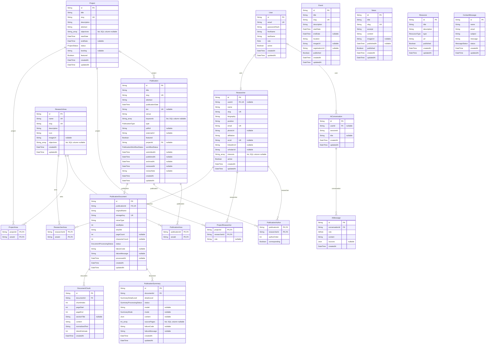

# Zey University Research Center — how to draw the MCD

Draw **one database model**. The three subject areas (accounts and research, publication documents, and public content and AI conversations) are only layout guides. This handout includes the **19 tables used by the application**, with **168 fields**, **17 foreign-key lines**, and **5 pivot tables**. It uses the actual database names so you can copy them directly onto your drawing.

## 1. Place the boxes on one landscape sheet

- **Center:** Put `Project`, `Researcher`, `ResearchArea`, and `Publication` near each other. Place each of the five pivot tables between its two parent tables.
- **Left:** Put `User` next to `Researcher`. Draw the AI branch from `User` to `AiConversation` to `AiMessage`.
- **Right:** Draw the document branch from `Publication` to `PublicationDocument`. Then branch to `DocumentChunk` and `PublicationSummary`.
- **Bottom:** Place `Event`, `News`, `Resource`, and `ContactMessage` in a row. These are used by the website, but have no foreign keys. Leave them as separate boxes. `ContactMessage.email` is a sender address and does not connect to `User.email`.

## 2. Mark the fields and draw the lines

- **PK** = primary key. **FK** = foreign key. **UK** = unique key. When two fields in a pivot are both marked **PK, FK**, they form **one composite primary key together**; each field also references its own parent.
- **1 to 1:** Each side can have at most one matching row. Example: one `Publication` can have zero or one `PublicationDocument`; every document belongs to exactly one publication.
- **1 to many:** A parent can have many child rows. Put the FK in the child table. Example: one `PublicationDocument` can have many `DocumentChunk` rows; each chunk belongs to one document.
- **Many to many:** Draw a pivot between the two main tables, and draw a **1-to-many line from each parent to the pivot**. Example: `Project` → `ProjectResearcher` ← `Researcher`. Do not add a second direct `Project`–`Researcher` line to the table diagram.

Use `1` for exactly one, `0..1` for optional one, `0..N` for zero or many, and `0..3` for zero through three. **On a line `A — B`, the mark next to `B` tells you how many `B` rows one `A` row can have.** For example, draw `Publication (1) — (0..1) PublicationDocument`. In the diagram below, a circle means optional, a bar means one, and a crow’s foot means many.

## 3. Copy these 17 foreign-key lines

| Relationship type | Mark at the right end | Mark at the left end | FK → referenced PK |
| --- | --- | --- | --- |
| `User` → `Researcher` (1 to 1, optional) | `0..1` | `0..1` | `Researcher.userId` → `User.id` |
| `User` → `AiConversation` (1 to many) | `0..N` | `0..1` | `AiConversation.userId` → `User.id` |
| `AiConversation` → `AiMessage` (1 to many) | `0..N` | `1` | `AiMessage.conversationId` → `AiConversation.id` |
| `Researcher` → `ResearcherArea` (1 to many) | `0..N` | `1` | `ResearcherArea.researcherId` → `Researcher.id` |
| `ResearchArea` → `ResearcherArea` (1 to many) | `0..N` | `1` | `ResearcherArea.areaId` → `ResearchArea.id` |
| `Project` → `ProjectArea` (1 to many) | `0..N` | `1` | `ProjectArea.projectId` → `Project.id` |
| `ResearchArea` → `ProjectArea` (1 to many) | `0..N` | `1` | `ProjectArea.areaId` → `ResearchArea.id` |
| `Project` → `ProjectResearcher` (1 to many) | `0..N` | `1` | `ProjectResearcher.projectId` → `Project.id` |
| `Researcher` → `ProjectResearcher` (1 to many) | `0..N` | `1` | `ProjectResearcher.researcherId` → `Researcher.id` |
| `Project` → `Publication` (1 to many) | `0..N` | `0..1` | `Publication.projectId` → `Project.id` |
| `Publication` → `PublicationAuthor` (1 to many) | `0..N` | `1` | `PublicationAuthor.publicationId` → `Publication.id` |
| `Researcher` → `PublicationAuthor` (1 to many) | `0..N` | `1` | `PublicationAuthor.researcherId` → `Researcher.id` |
| `Publication` → `PublicationArea` (1 to many) | `0..N` | `1` | `PublicationArea.publicationId` → `Publication.id` |
| `ResearchArea` → `PublicationArea` (1 to many) | `0..N` | `1` | `PublicationArea.areaId` → `ResearchArea.id` |
| `Publication` → `PublicationDocument` (1 to 1, optional) | `0..1` | `1` | `PublicationDocument.publicationId` → `Publication.id` |
| `PublicationDocument` → `DocumentChunk` (1 to many) | `0..N` | `1` | `DocumentChunk.documentId` → `PublicationDocument.id` |
| `PublicationDocument` → `PublicationSummary` (1 to many) | `0..3` | `1` | `PublicationSummary.documentId` → `PublicationDocument.id` |

`PublicationSummary` has one row per `(documentId, detailLevel)`. There are only three detail levels (`SHORT`, `STANDARD`, `DETAILED`), so label that end **0..3** if drawing by hand. Mermaid uses the generic crow’s foot for this relationship.

## 4. Draw these five many-to-many associations through their pivots

| Many-to-many association | Pivot table | Composite PK (both fields are also FKs) | Other fields in the pivot |
| --- | --- | --- | --- |
| `Researcher` ↔ `ResearchArea` | `ResearcherArea` | `researcherId`, `areaId` | — |
| `Project` ↔ `ResearchArea` | `ProjectArea` | `projectId`, `areaId` | — |
| `Project` ↔ `Researcher` | `ProjectResearcher` | `projectId`, `researcherId` | `role` (optional) |
| `Publication` ↔ `Researcher` | `PublicationAuthor` | `publicationId`, `researcherId` | `authorOrder`, `corresponding` |
| `Publication` ↔ `ResearchArea` | `PublicationArea` | `publicationId`, `areaId` | — |

For every pivot, each parent can have `0..N` pivot rows, and each pivot row must refer to exactly `1` row in each parent. The ten pivot lines are already included in the 17 lines above.

## 5. Combined diagram: copy these boxes and fields

In a strictly conceptual **MCD**, you can draw the five many-to-many associations directly and keep their association attributes. The combined drawing below is the **table-level ER diagram (MLD)**: it includes every field, PK/FK markings, and the actual pivot tables. Use this version if the assignment asks for keys and pivot tables on the drawing.

**Before submitting:** Count 19 boxes and 17 relationship lines. Check that each FK line reaches the referenced PK, all five pivots have two PK/FK fields, and the four standalone tables have no invented connections.
