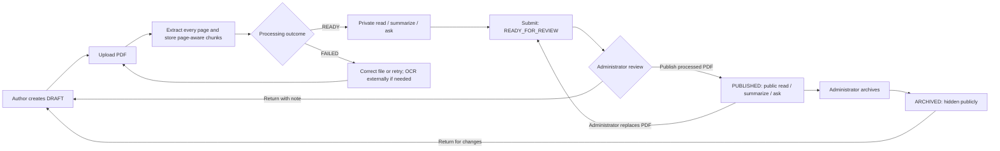

# Zey University Research Center — project and user guide

## Purpose

ZURC is a university research-center platform. It presents researchers, research areas, projects, publications, events, news and shared resources; provides search, contact forms and a research assistant; and supports controlled publication of complete research PDFs. React 19/Vite/TypeScript provides the interface; Express 5/TypeScript provides REST APIs; Prisma/PostgreSQL 16 stores structured data; JWT and bcrypt support authentication. Ollama runs the local qwen2.5:0.5b model. PDFs stay in private local storage; extracted text, chunks, summaries and AI conversations stay in the local database. No cloud AI API is used.

The demonstration data is fictional. The seeded twelve-page teaching paper permits checking methods, results and limitations against its actual pages. Older catalogue records are metadata-only: a title, abstract or external URL does not give the AI the full document.

## Roles and permissions

| Action                                                                      | Anonymous / visitor | Researcher                 | Administrator                                                             |
| --------------------------------------------------------------------------- | ------------------- | -------------------------- | ------------------------------------------------------------------------- |
| Browse public content and search                                            | Yes                 | Yes                        | Yes                                                                       |
| Contact the center                                                          | Yes                 | Yes                        | Yes                                                                       |
| Read a published READY PDF                                                  | Yes                 | Yes                        | Yes                                                                       |
| Summarize / ask about a published READY PDF                                 | Yes                 | Yes                        | Yes                                                                       |
| View private publication content                                            | No                  | Authored publications only | All publications                                                          |
| Edit researcher profile                                                     | No                  | Own linked profile         | Manage researcher records                                                 |
| Create publication drafts                                                   | No                  | Self assigned as author    | Through administration                                                    |
| Edit/upload publication PDFs                                                | No                  | Authored DRAFT only        | Manage publications; replacement of a published PDF requires review again |
| Submit a processed draft for review                                         | No                  | Authored drafts            | Yes                                                                       |
| Publish / return / archive publications                                     | No                  | No                         | Yes                                                                       |
| Manage users, areas, projects, events, news, resources and contact messages | No                  | No                         | Yes                                                                       |

Public registration always creates a VISITOR. It does not grant researcher privileges. An administrator assigns the RESEARCHER role and links the appropriate researcher profile to that user. A user account and a researcher profile are separate records; some researchers can have public profiles without login accounts. Inactive accounts cannot authenticate.

## Demonstration accounts

Login uses **email**, not a separate username field. These accounts are created only after the demo seed runs. Passwords in the database are bcrypt hashes, not plain text.

| Role / purpose                 | Email (login username)      | Password                      |
| ------------------------------ | --------------------------- | ----------------------------- |
| Administrator                  | admin@zurc-demo.edu         | Admin123!                     |
| Main researcher (Karim)        | researcher@zurc-demo.edu    | Research123!                  |
| Researcher (Leila)             | leila.nassar@zurc-demo.edu  | Research123!                  |
| Researcher (Youssef)           | youssef.amari@zurc-demo.edu | Research123!                  |
| Researcher (Sarah)             | sarah.khoury@zurc-demo.edu  | Research123!                  |
| Visitor                        | visitor@zurc-demo.edu       | Research123!                  |
| Student visitor                | student@zurc-demo.edu       | Research123!                  |
| Inactive-account negative test | inactive@zurc-demo.edu      | Research123! (login rejected) |

These are public demonstration credentials, not credentials for deployment with real data. An unseeded database does not automatically contain these users.

## Public visitor flow

1. Open the home page; browse areas, researchers, projects and publications.
2. Use search and filters to find research. Published records are linked to authors, research areas and optionally a project.
3. Open a publication. If a processed PDF exists, use Read PDF, Summarize and Ask this publication. Choose Short, Standard or Detailed, and follow page references to inspect the source.
4. Ask a concrete question about that paper's objective, methodology, findings or limitations. The answer identifies supporting pages. Missing evidence produces a cannot-determine response.
5. Browse events/news/resources or send a contact message. Optional registration gives visitor access, not author/publishing privileges.

## Researcher flow

1. Log in and open Researcher workspace (/researcher).
2. Update the linked profile's position, affiliation, biography and interests.
3. Choose New publication draft; enter publication metadata. The server assigns the current researcher as author.
4. Upload a text-based PDF. Default maximum: exactly 25 MiB. Wait for processing to become READY. Scanned/image-only files report OCR_REQUIRED; corrupt/encrypted or unavailable-storage errors are explained safely.
5. Read the PDF and preview summary/questions to inspect extraction and evidence. Draft content remains private.
6. Submit for review. Metadata and replacement controls become locked. The researcher cannot publish.
7. If the administrator returns it with a note, edit the DRAFT and resubmit. View publications grouped as editable drafts, under review, published and archived in the workspace.

Researchers receive 403 when managing a publication they do not author, even if they know its ID.

## Administrator flow

1. Log in as administrator and open /admin.
2. Manage users, researcher profiles and the content catalogue. Create or edit publication metadata and select relationships.
3. Open a publication's Document and review section. Inspect its PDF processing status and page count; read the full PDF and preview analysis.
4. Submit an administrator-created draft for review when its PDF is READY. Publish a READY_FOR_REVIEW record, or return it with an explanatory note.
5. Archive a published publication to remove public visibility. Archived work can be returned to draft.
6. Retry failed document processing when the underlying issue has been fixed. A replacement of a published PDF invalidates old summaries/chunks and moves it back to review before public exposure.
7. Review incoming contact messages and maintain events, news and resources.

Publication workflow (DRAFT / READY_FOR_REVIEW / PUBLISHED / ARCHIVED) is separate from document and summary processing (PENDING / PROCESSING / READY / FAILED). Replacing a PDF queues fresh extraction; publication remains private pending readiness and review.

## AI flow and limits

Center-wide assistant mode searches database metadata. Select a result's Read and ask link to enter publication-specific mode; that mode uses the uploaded PDF. It cannot read a paper solely from an external link, title or abstract.

Summarization processes every chunk through bounded local evidence batches and hierarchical reduction; it caches by document and requested detail level. Standard/Detailed contain In Short, Research Objective, Methodology, Key Findings, Conclusions, Limitations, Why It Matters and Keywords. Short provides an overview, findings and keywords. Verified passages/page provenance constrain unsupported output.

Questions retrieve relevant chunks plus adjacent-page context from the selected publication. Local Qwen generates an answer with supplied evidence. If generation is unavailable or invalid, deterministic fallback shows actual cited passages and is labeled FALLBACK. Questions/answers and evidence are persisted locally. Questions are answered independently; follow-up pronouns do not use previous conversation turns as context.

The 0.5B model can omit information or give weak synthesis; supporting pages should be checked. Citation validity is not a formal guarantee of semantic correctness. OCR and scholarly accuracy benchmarking are not implemented.

## Suggested university demonstration

1. Open Campus Water Sensor Evaluation (Teaching Fixture).
2. Generate Standard summary. Inspect Methods (pages 3–5), Results (6–8), Conclusions (11–12) and Limitations (12).
3. Ask “How many confirmed leaks were detected?” Expected fixture fact: nine of ten confirmed leaks, supported by the PDF.
4. Ask an unrelated question to demonstrate missing evidence.
5. Log in as researcher, create/upload/submit a draft, then log in as admin and review/publish it. Confirm anonymous users only see it after publication.
6. Optionally stop local Ollama to demonstrate labeled fallback, then restart it.

See [new-PC setup](NEW_PC_SETUP.md), [data models](DATA_MODELS.md) and [verification record](PUBLICATION_VERIFICATION.md).
